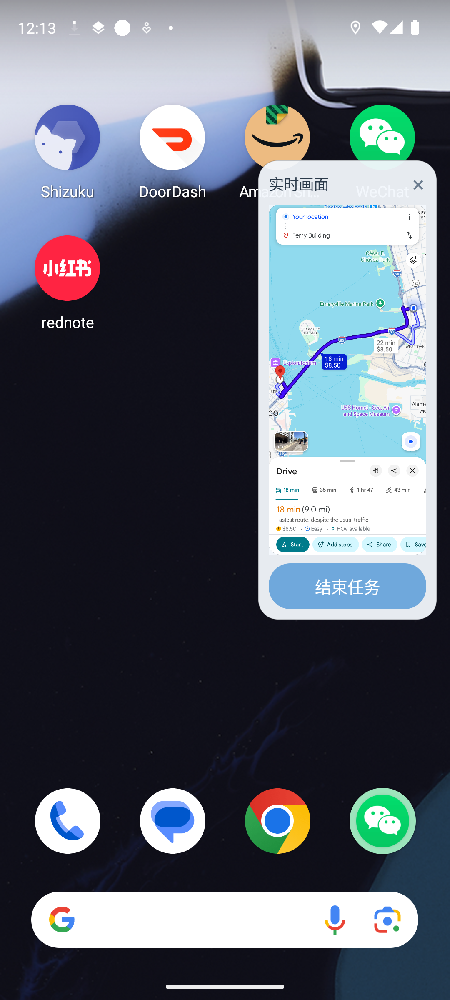
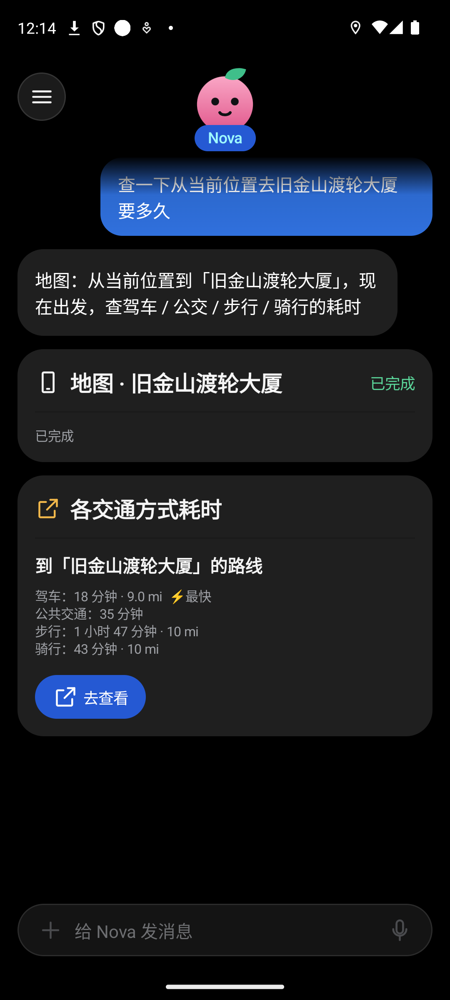
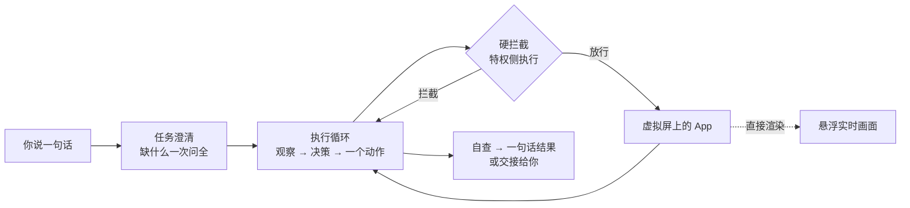

<div align="center">

# PhoneAgent

**一个在「看不见的第二块屏幕」上替你操作手机的 AI Agent。**
你照常用手机，它在后台把事办完。



&nbsp;&nbsp;&nbsp;


</div>

## 它是什么

对它说一句话：「去旧金山机场要多久」「给 Jerry 发微信，说我晚点到」「在 DoorDash 点一个 Shake Shack 的 Double ShackBurger」。

PhoneAgent 会创建一块**不显示在真实屏幕上的虚拟屏**，在上面启动并操作 Google 日历、Gmail、微信、Google 地图、DoorDash 等真实的第三方 App。你的屏幕、键盘和输入焦点完全不受影响，想刷视频、打字、回消息，都可以继续。需要看的时候，屏幕边缘有一个悬浮小窗，**实时**显示 Agent 正在做什么，随时可以点开全屏，或一键结束任务。

## 亮点

- **真正的「后台」操作**：不是在你眼前抢屏幕。虚拟屏带 `STEAL_TOP_FOCUS_DISABLED`，Agent 的点击、输入、返回键都定向到虚拟屏，不会抢走你的键盘和返回手势。
- **安全不靠模型自觉**：下单、付款、订阅会员、发送邮件和微信这类不可逆的动作，由运行在 shell 进程里的**硬拦截**把关，模型再怎么「想点」也点不到。邮件发送要经过内容哈希绑定的一次性放行。
- **看得懂界面，也看得懂「看不懂的界面」**：优先读无障碍树，精确按节点点击；遇到界面树读不出来的 App（如微信），自动切换成「截图 + 坐标网格 + 剪贴板粘贴」模式，仍然能完成任务。
- **实时画面直出**：悬浮窗和全屏观看页让虚拟屏直接渲染到 `SurfaceView`，没有逐帧截图的延迟，模拟器上实测约 60 帧/秒。
- **说一句话就办事**：先澄清（缺什么一次问全，相对日期由程序算好，不让模型心算），再执行；做完自查，结果卡片只给你一句话，不用你看步骤。
- **工程化扎实**：结构化输出约束模型回复、每次运行完整留痕（每步标注截图、模型输入输出、耗时、费用）、240+ 个单元测试、设备端回归脚本覆盖虚拟屏守卫、返回键和输入法隔离。

## 能做什么

| 任务 | 你说 | 它做 |
|---|---|---|
| 日历 | 「明天下午 3 点在日历加个事项：评审」 | 用意图预填新建页，本地核对一致后保存，再自查一次 |
| Gmail | 「给 Alice 发邮件，说周五评审改到 3 点」 | 写好主题和正文，**读出页面上实际内容请你确认**，确认后发送，并到「已发送」里核对 |
| 微信 | 「给 Jerry 发微信：晚上一起吃饭吗」 | 进入聊天、粘贴消息、发送，并核对消息已出现、没有失败标记 |
| Google 地图 | 「去旧金山机场要多久」 | 读开车要多久和距离，一键把地图交到你屏幕上 |
| DoorDash | 「点一个 Shake Shack 的 Double ShackBurger」 | 搜餐厅、加购、在购物车核对份数，走到结账页停下，**下单和付款由你亲手完成** |

> 原则：**能自己办的就自己办，不可逆的一步一定交给你。**

## 它是怎么工作的



分层与依赖方向（只向下依赖）：

```
 ui          Compose 对话界面 · 悬浮实时画面 · 全屏观看 · 引导
  │
 task        TaskCoordinator：澄清 → 执行 → 结果；事件流；悬浮窗控制器
  │
 agent       Clarifier · AgentLoop · 各任务流程（Email / Wechat / Maps / Doordash …）· Claude 客户端
  │
 perception  界面树 → 带编号元素 + 标注截图 + 稳定检测   ·   safety  硬拦截规则、发送闸门
  │
 privileged  Shizuku UserService（shell 权限）：虚拟屏、输入注入、UiAutomation、意图启动
```

更多细节：[`CLAUDE.md`](CLAUDE.md)（模块与依赖规则）· [`docs/PRD.md`](docs/PRD.md) · [`docs/dev-plan.md`](docs/dev-plan.md) · [`docs/DESIGN.md`](docs/DESIGN.md)

## 安全设计

PhoneAgent 能点屏幕上的任何东西，所以**最危险的按钮从一开始就不让它点**，而不是指望模型自己小心：

| 动作 | 保护方式 |
|---|---|
| 下单、付款（Place Order / Buy Now 等） | 特权侧硬拦截 + 结账页页面级锁定，Agent 只能停下来交给你 |
| 订阅会员、免费试用（Prime / DashPass） | 按钮级硬拦截，不依赖模型判断 |
| 发送邮件 | 你在确认卡片上确认的内容算哈希，点击发送时再核对一次，一致才放行**一次** |
| 微信发送 | 发送按钮和回车键都被拦截，只有流程自己布防的那一次放行 |
| 地图 | 只读，「开始导航」「保存」被拦截 |
| 其他 App | 只允许打开任务需要的 App，不会自己跑去别处 |

硬拦截在 UserService 进程里执行，模型的输出绕不过它，并且可以脱离模型单独做单元测试。

## 技术选型

| 选择 | 为什么选它 |
|---|---|
| **虚拟屏（VirtualDisplay）** | 要做到「你用手机，它在后台干活」，Agent 就不能占着你的屏幕。虚拟屏是系统自带的第二块屏，App 可以跑在上面，你的屏幕、键盘、焦点都不受影响。 |
| **Shizuku（shell 权限）** | 创建「可信」虚拟屏、把点击输入定向到虚拟屏、读另一块屏的界面树，这些普通 App 做不到，需要 shell 权限。Shizuku 让我们不用 root、不用改系统就能拿到，用户只需要授权一次。 |
| **界面树 + 截图一起用** | 界面树给每个按钮编号，点击能精确到具体控件，又快又准；截图给模型「看」界面。界面树读不出来的 App（比如微信），自动退回截图加坐标网格的模式。 |
| **Claude Haiku 5.5** | Agent 每一步都要调用一次模型，速度和成本最关键。Haiku 又快又便宜；稳定性靠代码补：日期由程序算好对照表、提示词带示例、每步做自查、失败自动重试。 |
| **结构化输出（JSON Schema）** | 让模型只能按固定格式回复动作，不会出现解析不了的自由文本，代码可以放心执行。 |
| **硬拦截放在特权进程** | 下单、付款、订阅、发送这类不可逆动作，由 shell 进程里的规则把关，模型输出绕不过去，也能脱离模型单独做单元测试。 |
| **SurfaceView 直出实时画面** | 悬浮窗里让虚拟屏直接渲染，省掉「截图 → 复制 → 缩放」的逐帧开销，画面更流畅；Agent 自己读屏另走一条 `PixelCopy` 的通道。 |
| **Kotlin + Jetpack Compose** | 原生 Android，能直接调用系统隐藏接口；Compose 写对话界面和卡片更快，主题统一管理颜色和字号。 |

## 落地到普通用户手机（后续规划）

目标是让普通用户下载一个 APK 就能用，不需要电脑、不需要 root：

1. **下载并安装 APK**：从 GitHub Releases 下载 PhoneAgent，直接在手机上安装。
2. **首次打开，App 引导你开启 Shizuku**：一步一步带你安装、启动并授权 Shizuku，再开启悬浮窗权限。
3. **在 Agent 里填入自己的 Claude API Key**：Key 存在系统 Keystore 里，请求直接发给 Claude，不经过任何第三方服务器。
4. **开始对话**：说一句话，Agent 在后台虚拟屏上办事，你照常用手机。

**后续将开发**
- 设置页里让用户填写并保存自己的 API Key（目前 Key 只来自本地开发配置）。
- 首次打开的引导流程：检查 Shizuku 与各项权限，缺什么就告诉用户下一步点哪里。
- 签名的 release APK，发布到 GitHub Releases。
- 真机验证与主流厂商 ROM 适配：所有对系统隐藏接口的调用都收敛在 `privileged` 一层，适配只需要改这一层；`scripts/regress.sh` 可以在新设备上快速回归。
- 更多 App 的任务模板。

## 如何运行

1. **环境**：Android Studio 模拟器（Pixel 8，Android 14，带 Google Play），登录 Google 账号，装好日历、Gmail、Google 地图；要试微信和 DoorDash 任务，需要装好并登录对应 App。
2. **Shizuku**：安装 Shizuku，用 adb 或无线调试启动，并授权给 PhoneAgent。
3. **API Key**：在项目根目录 `local.properties` 里加一行 `CLAUDE_API_KEY=你的key`。该文件已被 `.gitignore`，Key 只注入 **debug** 构建，不会进入 Git。
4. **构建安装**：
   ```bash
   JAVA_HOME="/Applications/Android Studio.app/Contents/jbr/Contents/Home" ./gradlew installDebug
   ```
5. **悬浮窗权限**（任务执行时显示实时画面）：首次引导里点「去开启」，或
   ```bash
   adb shell appops set com.android.phoneagent SYSTEM_ALERT_WINDOW allow
   ```
6. 打开 PhoneAgent，在对话里试试：
   - 「明天下午 3 点在日历加个事项：和 Alice 评审方案」
   - 「去旧金山机场要多久」
   - 「给 Jerry 发微信：晚上一起吃饭吗」
   - 「在 DoorDash 点一个 Shake Shack 的 Double ShackBurger，其他选项都用默认」

更多试玩说明见 [`docs/how-to-try.md`](docs/how-to-try.md)。

**测试**：`./gradlew testDebugUnitTest`（单元测试，不联网）· `bash scripts/regress.sh`（设备端底层回归）

> ⚠ debug 构建的 APK 里带着你的 API Key，不要提交、上传或分享。

## 技术栈

Kotlin · Jetpack Compose · Shizuku · Android 隐藏接口（VirtualDisplay / UiAutomation / ActivityTaskManager）· Anthropic Claude（结构化输出，Haiku 5.5 做每步决策与自查）

## 目录

```
app/        源码（按 ui / task / agent / perception / safety / privileged 分包）
docs/       PRD、设计稿、开发计划、验证记录、截图
scripts/    设备端回归、真实任务测试、样本脱敏等脚本
```

后续规划见上面的「落地到普通用户手机」。
